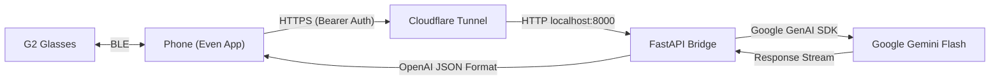

# EvenG2-to-Gem-BYOA

A lightweight Python backend bridge connecting **Even Realities G2 smart glasses** (via the Bring Your Own Agent / BYOA feature) to **Google's Gemini models**.

---

## 1. Overview & Goals

* **Core Purpose:** Bridge the Even companion app's OpenAI-compatible BYOA interface to the Google Gemini API using FastAPI and the official `google-genai` SDK.
* **Why Gemini Flash?** Low latency and fast time-to-first-token are essential for a heads-up display (HUD). Gemini Flash provides fast, cost-effective inference.
* **HUD-First Formatting:** Standard LLM outputs contain markdown, bolding, lists, and long paragraphs that clutter the G2's monochrome MicroLED display. The bridge injects system constraints so responses remain concise (1–3 sentences) and plain text.
* **Turn Flexibility:** Supports single-shot queries and passes multi-turn conversation history when sent by the client.

---

## 2. Architecture & Data Flow



---

## 3. Authentication & Security (Two Key Layers)

Because the proxy is exposed to the internet via Cloudflare Tunnel, robust authentication is critical to prevent unauthorized users from hijacking your endpoint and consuming your Gemini API quota.

| Key / Token | Stored In | Purpose | Who Uses It |
| :--- | :--- | :--- | :--- |
| **`PROXY_API_KEY`** (Shared Secret) | `.env` & Even App | Protects the bridge endpoint from public access. The Even App sends this in the `Authorization: Bearer <KEY>` header. | Even App ➔ FastAPI Bridge |
| **`GEMINI_API_KEY`** | `.env` (Server only) | Authenticates outbound requests to Google AI Studio. **Never** exposed to the phone or glasses. | FastAPI Bridge ➔ Google Gemini |

---

## 4. Prerequisites

1. **Hardware:**
   * Even Realities G2 smart glasses + Even companion app (iOS / Android).
   * Host machine (local PC, home server, or Linux VPS) with internet access.
2. **Accounts & Keys:**
   * [Google AI Studio API Key](https://aistudio.google.com/) (`GEMINI_API_KEY`).
   * **EvenHub Developer Access:** You must be enrolled as an EvenHub developer (or toggle Developer Mode in app settings) to unlock the `Settings → Even AI → Agent Configuration` menu.
3. **Software:**
   * Python 3.10+
   * `cloudflared` (Cloudflare Tunnel CLI)

---

## 5. Quickstart Setup

### Step 1: Clone & Install Dependencies
```bash
git clone https://github.com/SV-Engineer/EvenG2-to-Gem-BYOA.git
cd EvenG2-to-Gem-BYOA

# Create and activate virtual environment
python -m venv .venv
source .venv/bin/activate  # On Windows: .venv\Scripts\activate

# Install requirements
pip install -r requirements.txt
```

### Step 2: Configure Environment Variables
Create a `.env` file in the project root:

```env
# Server Configuration
HOST=0.0.0.0
PORT=8000

# Security (Choose a strong random token to protect your bridge)
PROXY_API_KEY=your_secure_custom_token_here

# Google Gemini Configuration
GEMINI_API_KEY=your_google_ai_studio_api_key_here
GEMINI_MODEL=gemini-2.5-flash

# HUD Prompt Tuning (Tailored for G2 MicroLED display)
HUD_SYSTEM_PROMPT="You are an assistant displayed on smart glasses heads-up display. Respond in 1 to 3 short sentences. Use plain text only. Never use markdown, bolding, bullet points, or asterisks."
```

### Step 3: Expose via Cloudflare Tunnel

Cloudflare Tunnel provides free, instant HTTPS without port forwarding or exposing your home IP:

* **Quick / Ephemeral Tunnel (Easiest for testing):**
  ```bash
  cloudflared tunnel --url http://localhost:8000
  ```
  *Copy the generated `https://<random-id>.trycloudflare.com` URL.*

* **Persistent Named Tunnel (Recommended for daily use):**
  If you have a domain on Cloudflare:
  ```bash
  cloudflared tunnel create even-g2-bridge
  cloudflared tunnel route dns even-g2-bridge g2.yourdomain.com
  cloudflared tunnel run even-g2-bridge
  ```

### Step 4: Configure the Even Companion App
1. Open the **Even Realities** app on your phone.
2. Navigate to **Settings** ➔ **Even AI** ➔ **Agent Configuration** (requires developer mode enabled).
3. Configure the following fields:
   * **Endpoint URL:** `https://<your-tunnel-url>/v1/chat/completions`
   * **API Key:** Paste your `PROXY_API_KEY` (must match the value in `.env`).
4. Save and test by activating Even AI on your G2 glasses.

---

## 6. Development Roadmap

- [ ] **Phase 1: Minimal Working Prototype**
  - [x] Architecture & README design
  - [ ] FastAPI server implementing `/v1/chat/completions` (OpenAI request/response schema)
  - [ ] Bearer token authentication middleware
  - [ ] Google GenAI SDK integration (`gemini-2.5-flash`)
- [ ] **Phase 2: HUD Formatting & Tuning**
  - [ ] System prompt injection for MicroLED character limits
  - [ ] Response length guards & text cleaner (stripping markdown / asterisks)
  - [ ] Streaming support (`stream: true` chunk delivery for lowest latency)
- [ ] **Phase 3: Deployment & Automation**
  - [ ] Dockerfile & `docker-compose.yml` with optional integrated `cloudflared` container
  - [ ] One-script setup for systemd / daemon services
- [ ] **Phase 4: Advanced Features**
  - [ ] Multi-agent / multi-model selector (Gemini Pro, Claude, local Ollama)
  - [ ] Function calling & external tools (weather, calendar, search)

---

## 7. Disclaimer & Transparency

This codebase utilizes an AI agent to support development and maintenance. The LLM offering this support is Gemini. The use of AI in this context is to reduce development time and accelerate prototyping.
